# Draconic Evolution for Minecraft 26.1.2 — restjack fork (`eli/upstream-fixes`)

> **This branch** = [TasteFu1's unofficial 26.1.2 port](https://github.com/TasteFu1/Draconic-Evolution/tree/port/26.1.2-neoforge) **plus bug fixes and optional extras** found and built while running it on a dedicated server (FTB Evolution 2).
> Our own fixes are also offered upstream as [TasteFu1/Draconic-Evolution#1](https://github.com/TasteFu1/Draconic-Evolution/pull/1).
> Not affiliated with or endorsed by brandon3055. All credit for Draconic Evolution goes to him; the port itself is TasteFu1's and MehanikTMYT's work.

Current build: **`3.1.4-unofficial-1.0`** (jar `Draconic-Evolution-26.1.2-3.1.4-unofficial-1.0.jar`; earlier builds were named `port.3-eli.N`).

## A look at it

| Core Monitor, 4×4 (core picture, stat cards, graph) | Core Monitor close-up |
| --- | --- |
| 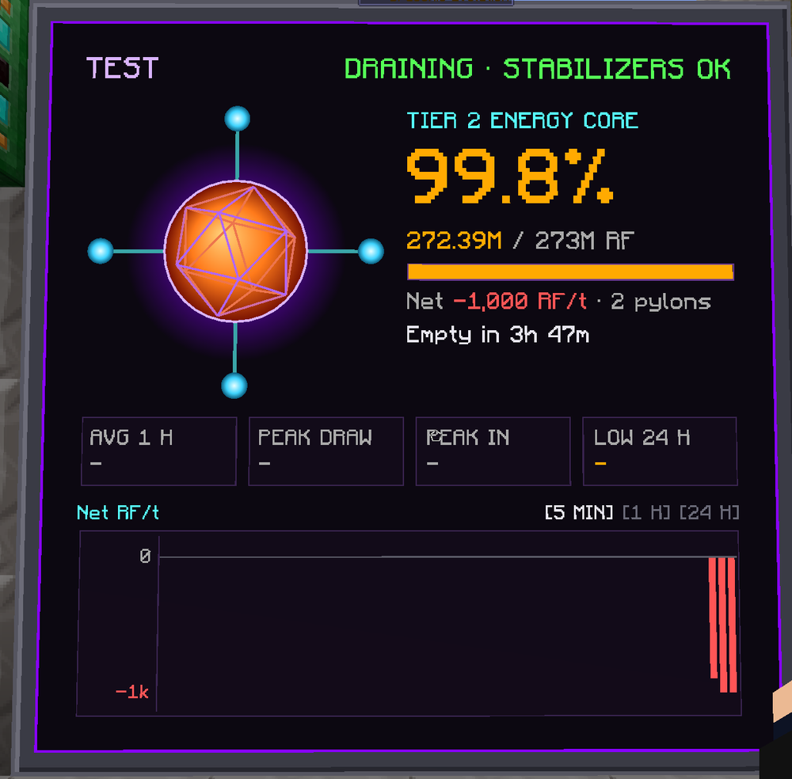 | 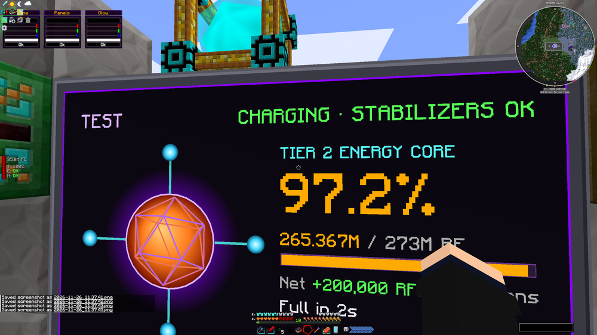 |

| Monitor settings: Control (core power, next tier) | Monitor settings: Stats |
| --- | --- |
| 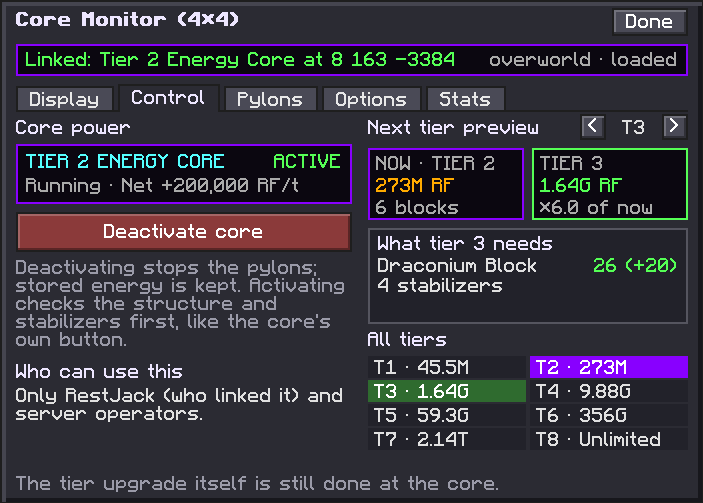 | 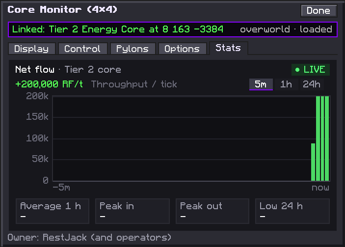 |

| Energy core screen (In / Out / Net, rate graph) | In-game guide (Patchouli book; same guide in GuideME, hold G) |
| --- | --- |
| 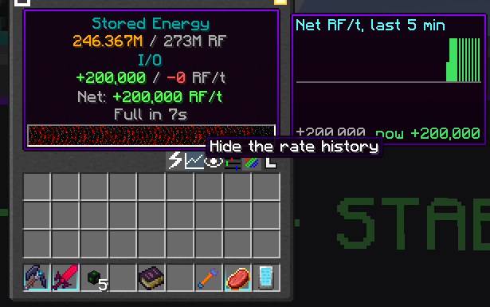 | 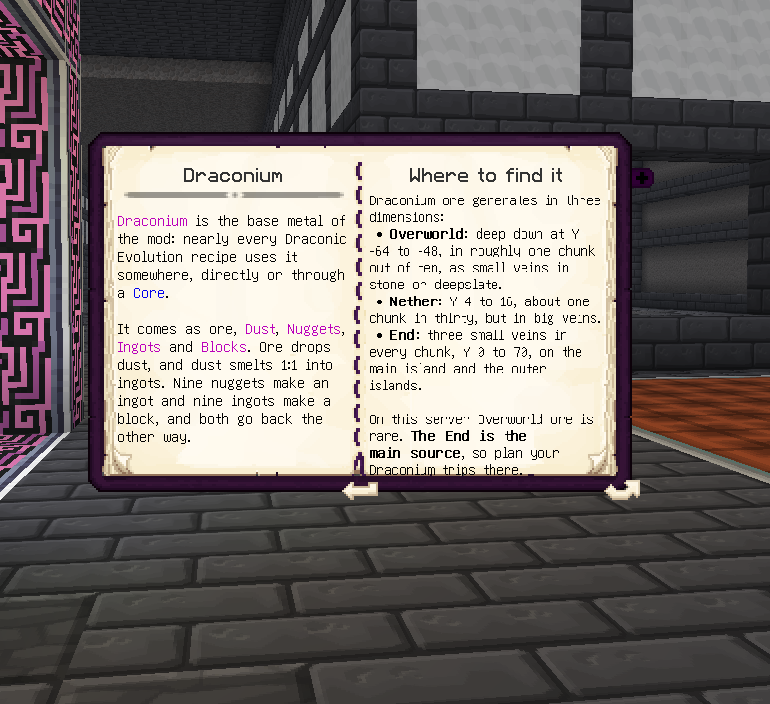 |

**Core Monitor screen sizes** (panels facing the same way join into one screen; bigger shows more):

| 1×1 | 2×1 | 3×1 |
| --- | --- | --- |
| 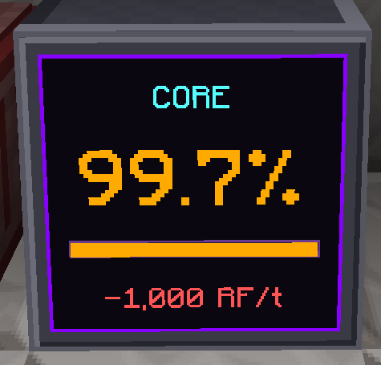 | 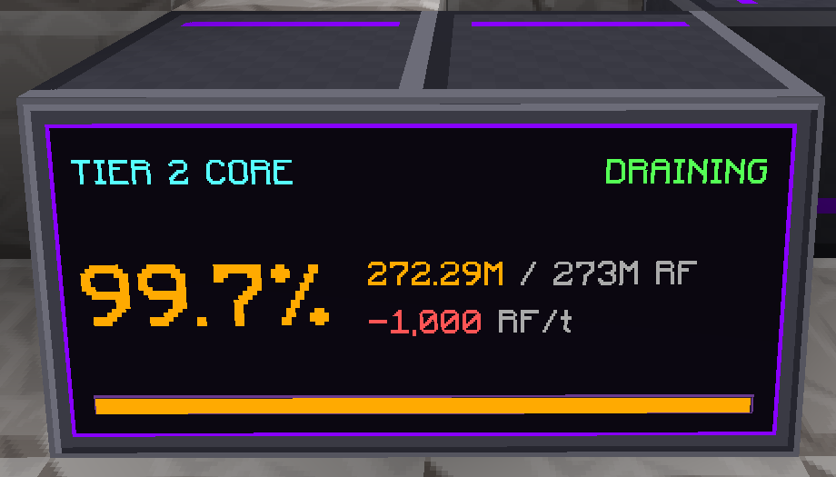 | 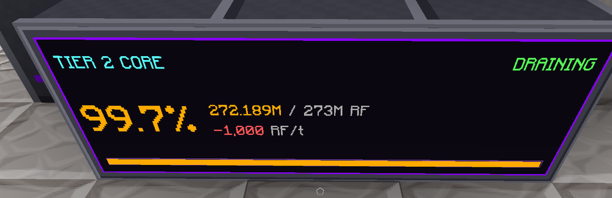 |

| 1×2 | 2×2 | 3×3 / 4×4 |
| --- | --- | --- |
| 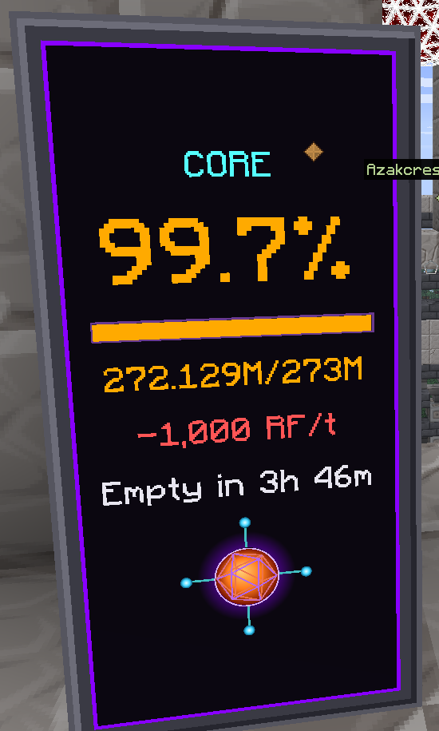 | 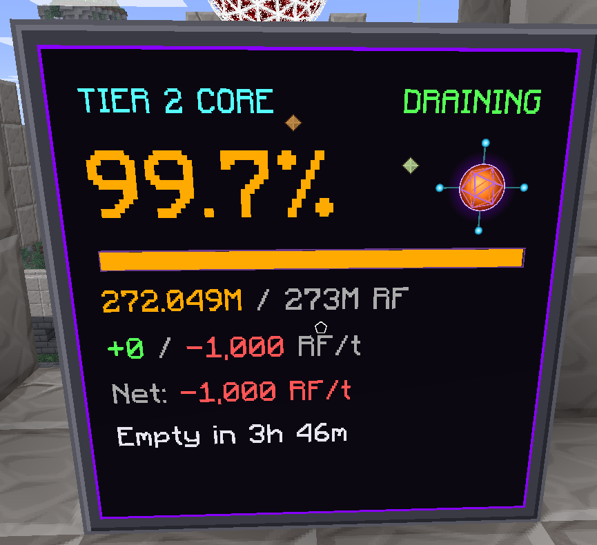 |  |

More: [Display tab](.github/readme/monitor-settings-display.png) · [Pylons tab](.github/readme/monitor-settings-pylons.png) · [Options tab](.github/readme/monitor-settings-options.png) · [monitor and core, angled](.github/readme/core-monitor-angle.png) · [GuideME page for the Core Monitor](.github/readme/guideme-core-monitor.png)

## What this branch adds

### Fixes (always on)

| Fix | Effect in game |
| --- | --- |
| Stabilizer beam direction | Energy core stabilizer beams point into the core (were all pointing north). |
| `ModelMat` shader fix | Stabilizer orbs, pylon shells and the legacy core shell render on the block (they were floating around the camera, often seen as big cyan shapes in four directions). |
| Live machine screens | The energy core screen (and every DE machine screen) updates stored OP and I/O while open. |
| Block effects switch | Client option `blockEffectRendering`, or the **eye button** on the energy core screen. Hides core, stabilizer, pylon and reactor visuals **for that player only**; the blocks keep working, and the structure blocks show as plain blocks. A safety valve if they render wrong or crash your graphics. |
| Powah / zero-buffer cables | Pylons and other DE machines push energy straight into cables that store nothing (e.g. Powah) (Brandon's Core `port.2`). |
| JEI fusion recipes | The port only had EMI support. The server now sends fusion recipes to clients (needed since MC 1.21.2) and a JEI category shows them. Needs this build on the server too. |
| Crystal Binder crash | Holding a bound binder no longer crashes the game (26.1 line vertices need a line width). |
| Quantum Energy Tunnel | A capacitor's energy-link module no longer sticks at "0% linking" after a disconnect when the capacitor is empty; the core pays the re-link charge (upstream #1968). |
| More upstream bug fixes | Crafted modular items stack (#2040). Auto-Feed no longer eats infinite foods (#2017). Mob Grinder XP can be piped out as any `c:experience` liquid (#1955). Core blocks are tagged `c:relocation_not_supported`, so AE2 Spatial IO won't move them (#1931). |
| Upstream 1.21 fixes (open PRs [#2044](https://github.com/Draconic-Inc/Draconic-Evolution/pull/2044), [#2046](https://github.com/Draconic-Inc/Draconic-Evolution/pull/2046), [#2050](https://github.com/Draconic-Inc/Draconic-Evolution/pull/2050), [#2051](https://github.com/Draconic-Inc/Draconic-Evolution/pull/2051), [#2052](https://github.com/Draconic-Inc/Draconic-Evolution/pull/2052), [#2053](https://github.com/Draconic-Inc/Draconic-Evolution/pull/2053)) | Stabilizer disintegration, Draconium Chest losing shift-clicked items, constant module re-saves, night-vision packet spam, crystals/pylons/reactors keeping far chunks loaded, crystal network spam, dislocator limits. #2052 is adapted to the port; #2053's arena-check commit is left out on purpose (it can stop the guardian spawning on servers with view distance < 8). |

### Extras (each can be switched off, see below)

| Extra | What it does |
| --- | --- |
| **Core Monitor** block | A screen for an energy core, readable from anywhere (even another dimension; never force-loads chunks). Panels facing the same way join into one screen up to **4×4**; bigger screens show more: graph from 3×2, stat cards and an animated picture of the core from 3×3. Link with a Crystal Binder (Shift-click the core, then a panel). Right-click for settings: what to show, OP/RF/FE/J, warning and alarm levels; turn the core on/off and preview the next tier; every pylon with its rate, a remote INPUT/OUTPUT switch and a **locate pin** that outlines it through walls; core-wide input/output limits and a reserve; alerts (chat, toast, sound, FTB Teams party); redstone output; a CC: Tweaked peripheral `draconic_monitor`; stats and graphs over 5 min / 1 h / 24 h. Only the player who linked it (and operators) can change it. |
| Energy core screen | Stored / capacity, In, Out, Net and time to full or empty; short numbers (271.781M); OP/RF button; a 5-minute rate graph; a broken structure says how many blocks are wrong and where. |
| Pylons | Green (input) or red (output) textures and particles, and the new mode named on the action bar when toggled. |
| Stabilizer beam force field | Living things in a stabilizer beam are pushed out and take half a heart (server options: damage, push, players, mobs). |
| Jade tooltips | Core, pylons and stabilizers (Shift for in/out and time to full/empty). |
| In-game guide | A Patchouli book (*Draconic Evolution Guide*, 41 entries) and the same guide for GuideME (hold **G** over an item). Crafted from a Book and Draconium Dust; the Information Tablet opens it too. |
| HD textures | Two built-in resource packs, *Draconic Evolution: core & pylons 32×* and *64×*, plus *Classic 16×16*. |

Mod version string: `3.1.4-unofficial-1.0` (Brandon's Core `3.2.1+26.1.2-port.2`). Needs NeoForge **26.1.2.126 or newer** (below 26.2), Minecraft 26.1.2, Java 25.

## Installing

There are **no prebuilt downloads**. Draconic Evolution's licence does not allow redistributing the mod, so build it yourself (below). Put the three jars in `mods/` on **every client and the server**, and remove any older Draconic Evolution jar first (two copies crash the game). Optional on clients: Jade (tooltips), JEI (fusion recipes), Patchouli or GuideME (guide), CC: Tweaked (monitor peripheral).

| File (from the build) | Provides |
| --- | --- |
| `Draconic-Evolution-26.1.2-3.1.4-unofficial-1.0.jar` | Draconic Evolution |
| `BrandonsCore-3.2.1+26.1.2-port.2.jar` | Brandon's Core |
| `codechickenlib-4.7.0+26.1.2-port.2.jar` | CodeChickenLib |

Sharing the jars privately with your own modpack/server players is covered by brandon3055's modpack permission. Please don't upload them anywhere public.

## Building (incl. Windows traps)

Needs Git, Python 3.8+ and a **JDK 25**. Then, from this branch:

```sh
python gradle/build-port.py assemble     # or "build" to also run tests
```

On **Windows** two things break the build; both have easy workarounds:

1. **Git line endings.** With Git's default `core.autocrlf=true`, the port's `.patch` files and the library checkouts get CRLF, and `git apply` fails with "patch does not apply". Clone with `git clone -c core.autocrlf=false …`, and run the build with the override for the library checkouts:
   ```sh
   GIT_CONFIG_COUNT=1 GIT_CONFIG_KEY_0=core.autocrlf GIT_CONFIG_VALUE_0=false python gradle/build-port.py assemble
   ```
2. **Gradle can't download Java 25 itself** (the pinned foojay plugin is too old for Gradle 9: `JvmVendorSpec does not have member field ... IBM_SEMERU`). Point it at a local JDK 25 instead (e.g. an unpacked Temurin 25 zip):
   ```sh
   export JAVA_HOME=/path/to/jdk-25
   export GRADLE_OPTS="-Dorg.gradle.java.installations.paths=/path/to/jdk-25 -Dorg.gradle.java.installations.auto-download=false"
   ```

Output: `.gradle/port-work/Draconic-Evolution/build/libs/` (the mod) and `.gradle/port-work/deps/` (the two libraries). `assemble` is enough; the unit-test stage needs the same JDK setup.

## Optional extras (and turning them off)

Our own features (not the bug fixes) each have a switch in `config/brandon3055/DraconicEvolution.cfg`, section `Extras`:

- `Client` (per player): `extras` (master), `coreScreenDetails`, `coreGraph`, `coreUnitToggle` (OP/RF button), `structureHints`, `pylonModeColours`.
- `Server` (synced to joining clients): `extras` (master), `grinderXpPiping`, `guideBookRecipe`, `coreRateHistory`, `pylonModeMessage`, `coreMonitor` (block, recipe and everything it does), `beamForceField` with `beamPush`, `beamAffectsPlayers`, `beamAffectsMobs` and `beamDamage` (damage points: 1 = half a heart, 0 = none).

Each part's master `extras` switch off gives the official mod's behaviour.

**Modpack defaults:** this file is not a NeoForge config, so NeoForge's `defaultconfigs/` does not seed it. Use a
config-seeding mod such as Configured Defaults (FTB packs ship it): put your `DraconicEvolution.cfg` at
`configureddefaults/config/brandon3055/DraconicEvolution.cfg`. It is copied only when the player has no such file yet,
and missing values are filled with the defaults, so a file holding only the `Extras` section works.

## Adding it to an existing world

- Draconic Evolution's ore generates only in **newly generated chunks**. A world explored (or pregenerated) before you added the mod has no Draconium there.
- **Retrogen:** `extras/ftb-evolution-2/kubejs/` has a KubeJS 8 script pair (`startup_scripts/retrogen_hook.js` + `server_scripts/systems/retrogen.js`). It adds DE's own ore features to old chunks once each, at DE's own rates, and skips brand-new chunks. Copy both, then fully restart.
- **Chaos Islands** generate every `chaosIslandSeparation` blocks (default 10000) in the End, never at 0,0. With a world border smaller than that, lower it (e.g. `2000`) **before** the End generates, and restart fully; DE reads it at startup only. An already-generated End needs its terrain reset (keep each dimension's `data/` folder, which holds the world border).
- **Mystical Agriculture** ships a Draconium ore-infusion recipe with an outdated item id. `extras/ftb-evolution-2/kubejs/server_scripts/recipes/draconic_mystical_compat.js` re-adds it with the right one.
- **JEI tidy-up (client side):** `extras/ftb-evolution-2/config/collapsiblegroups/groups/` has five group files for the Collapsible Groups mod that fold DE's modules into armour, energy, projectile, shield and tool groups in JEI. Copy them into the client's `config/collapsiblegroups/groups/`.

## Known issues (upstream, not fixed here)

- Chaos Guardian fight: upstream reports it getting stuck in one attack mode, double spawns and an invulnerable crystal after a mid-fight restart. Back up before fighting. (The "crash on right-clicking a guardian crystal" report was caused by another mod, Cognition, and does not apply to this port.)
- Reactor: upstream reports it sometimes jumping straight to 2,500 °C on start-up. Test a reactor in a copy of your world first.
- Ender Collection module: bound to an EnderStorage chest, it still sends to the default one (upstream #1996). Without EnderStorage it uses the vanilla ender chest as intended.
- The Information Tablet has no recipe (also true in official 1.21.1; it needs Project Intelligence).

---

*TasteFu1's original README for the port follows.*

# Draconic Evolution

## Minecraft 26.1.2 · NeoForge

This branch is an unofficial port of Draconic Evolution by brandon3055. It builds on [the original 1.21 branch](https://github.com/Draconic-Inc/Draconic-Evolution/tree/1.21) and [MehanikTMYT’s 26.1.2 migration](https://github.com/MehanikTMYT/Draconic-Evolution/tree/port/26.1.2).

### Installation

Use Java 25 and Minecraft **26.1.2** with NeoForge **26.1.2.126**. Place the following three files together in the instance’s `mods` directory on the client and the dedicated server.

| File | Provides |
| --- | --- |
| `Draconic-Evolution-26.1.2-3.1.4-port.3.jar` | Draconic Evolution |
| `BrandonsCore-3.2.1+26.1.2-port.2.jar` | Brandon’s Core |
| `codechickenlib-4.7.0+26.1.2-port.2.jar` | CodeChicken Lib and its embedded Quack library |

### Classic 16×16 textures

Classic 16×16 is the default look from the first launch. The mod includes pixel-art tools in hand and in the inventory, animated bows, and classic textures for blocks and modules. The 23 modular equipment items use 16×16 sprites. Equipped chestpieces use the standard Minecraft armor shape and its 64×32 texture sheet. The build also produces a standalone ZIP in `Draconic-Evolution/build/distributions` under the build directory.

The classic sprites include artwork by enemeez1 and 5284973. The pack includes the source credits and licenses. [Original 16× texture pack](https://www.curseforge.com/minecraft/texture-packs/improved-draconic-evolution-16x-textures/files/2581395)

### Tested on 26.1.2

The client entered singleplayer and joined a dedicated NeoForge server with the three jars listed above. Both loaded all 179 Draconic Evolution recipes, including 39 fusion recipes.

Gameplay checks covered crafting a Wyvern Sword using six injectors and eight million OP, installing and charging a Wyvern energy module, using a bound Dislocator, linking energy crystals, and assembling a reactor. A server restart preserved machine inventories, energy and filters. World generation produced Draconium ore in the Overworld and a Chaos Island with its crystal in the End.

### Building from source

Install Git, Python 3.8 or later and a JDK 25. From the root of this branch run the following command.

```sh
python gradle/build-port.py build
```

The script builds the pinned library sources, applies the port’s patches and runs the Draconic Evolution Gradle build. Set `DE_BUILD_ROOT` to choose the working directory. It defaults to `.gradle/port-work` inside the checkout. The finished mod is under `Draconic-Evolution/build/libs` in that directory, and its two required libraries are under `deps`. All three projects retain their original licenses.

[](https://www.curseforge.com/minecraft/mc-mods/draconic-evolution)
[](https://www.curseforge.com/minecraft/mc-mods/draconic-evolution/files)
[](https://discord.gg/e2HBEtF)
[](https://nexus.covers1624.net/#browse/browse:maven-hosted:com%2Fbrandon3055%2Fdraconicevolution%2FDraconic-Evolution)
[](https://www.patreon.com/brandon3055)

Draconic Evolution adds powerful new tools, Items, weapons and Armor. The premise is the enigmatic ore - Draconium. As you progress you find it has many uses from the mundane such as machines and items, to the near-mystical at the top with Awakened Draconium to make extremely powerful armor and tools.

## License / Use in Modpacks
This mod is licensed under the [**Don't Be a Jerk License**](https://github.com/Draconic-Inc/Draconic-Evolution/blob/HEAD/LICENSE.md) created by CoFH.
I hereby grant permission to use this mod in any mod pack without the need to request permission from myself the owner (brandon3055).
